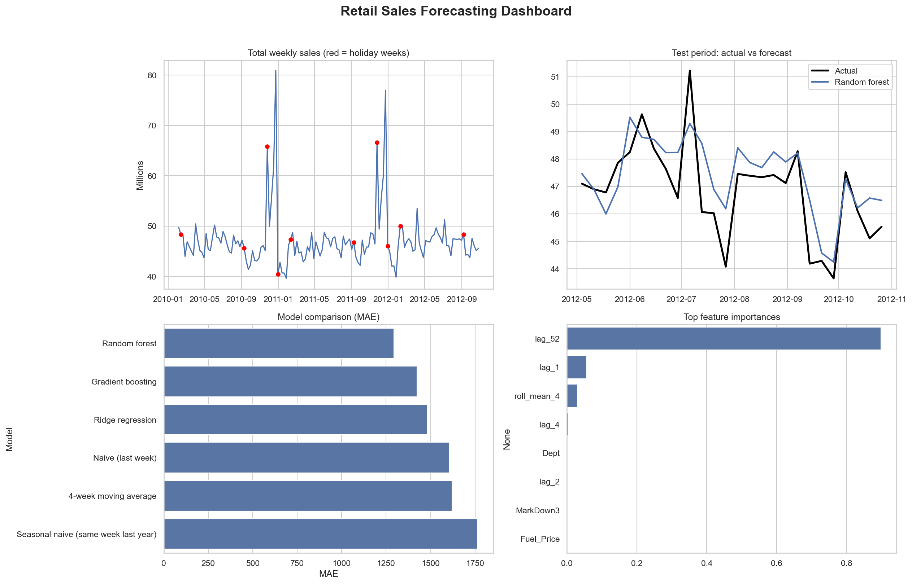
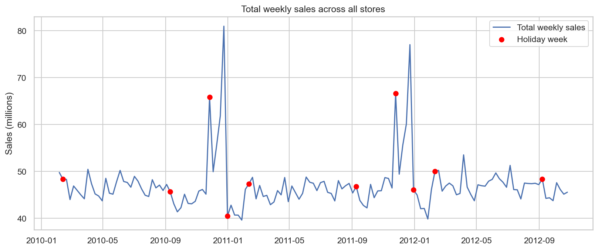
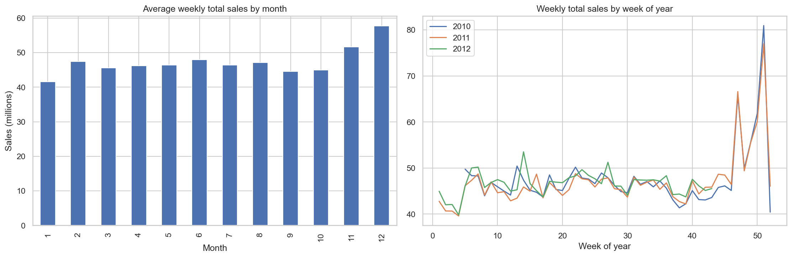
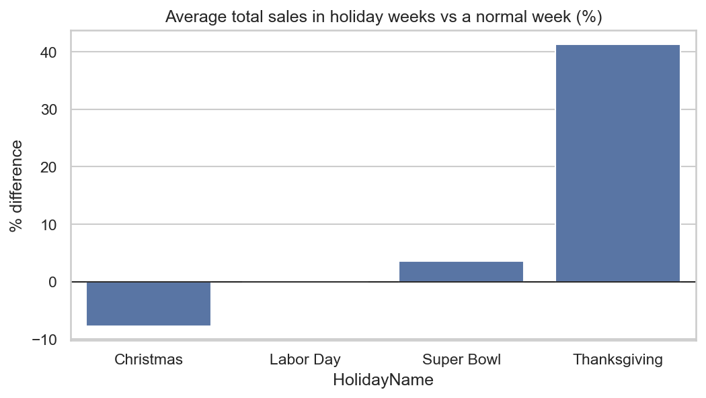
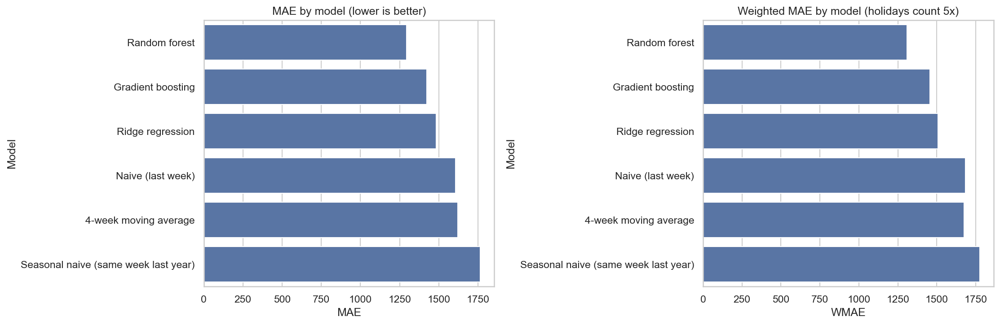
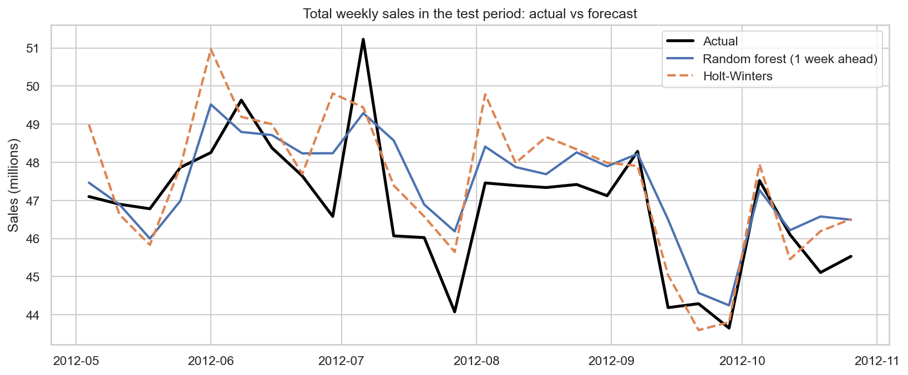
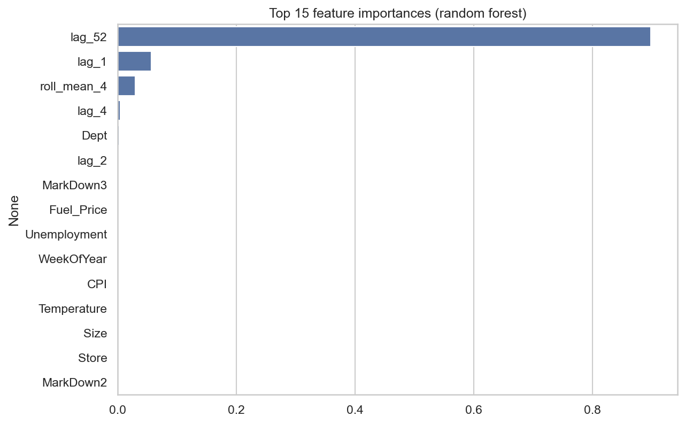
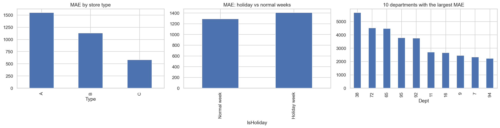

# 📊 Retail Sales Forecasting

A Machine Learning project focused on analysing historical retail sales data, identifying sales trends and seasonal patterns, and forecasting future sales using statistical and machine learning models.

**Dataset:** Walmart Recruiting – Store Sales Forecasting (Kaggle)

---

## 📌 Project Overview

Retail businesses need accurate sales forecasts to make better decisions about inventory management, staffing, budgeting and business planning.

This project analyses historical weekly sales data from multiple retail stores and departments to identify sales patterns and build forecasting models.

The project explores different forecasting approaches and compares their performance to understand how accurately they predict retail sales.

## 🎯 Project Objectives

- Analyse historical retail sales data.
- Identify overall sales trends and patterns.
- Explore weekly and seasonal variations in sales.
- Analyse the impact of holidays on retail sales.
- Examine sales patterns across different store types and sizes.
- Investigate the influence of external factors on sales.
- Build and compare multiple forecasting models.
- Evaluate actual sales against predicted sales.
- Identify important features influencing sales forecasts.
- Analyse forecasting errors and model performance.

## 📂 Dataset Description

The project uses the Walmart Recruiting – Store Sales Forecasting dataset.

| File | Description |
|---|---|
| `train.csv.zip` | Historical weekly sales data |
| `features.csv.zip` | External factors and additional features |
| `stores.csv` | Store information and characteristics |
| `test_predictions.csv` | Generated sales predictions |

## 🛠️ Technologies Used

- **Programming Language:** Python
- **Data Analysis:** Pandas, NumPy
- **Data Visualization:** Matplotlib, Seaborn
- **Machine Learning:** Scikit-learn
- **Development Environment:** Jupyter Notebook

## 🔄 Project Workflow

### 1. Data Loading and Inspection
- Loaded the retail sales datasets.
- Inspected data structure, columns and data types.
- Examined missing values and dataset characteristics.

### 2. Data Preprocessing
- Prepared the datasets for analysis.
- Combined relevant sales, store and external feature information.
- Prepared features for forecasting.

### 3. Exploratory Data Analysis (EDA)

Performed detailed analysis to understand retail sales behaviour.

The analysis includes:

- Total Sales Trend Analysis
- Seasonality Analysis
- Holiday Effect Analysis
- Store Type and Size Analysis
- Top Performing Stores and Departments
- External Factors Analysis

### 4. Forecasting Model Development

Implemented and compared different forecasting approaches:

- Ridge Regression
- Random Forest
- Holt-Winters Exponential Smoothing

### 5. Model Evaluation

Compared model performance using forecasting errors and actual-versus-predicted sales visualisations.

### 6. Feature Importance

Analysed feature importance using the Random Forest model to identify the factors contributing to sales predictions.

### 7. Error Analysis

Examined prediction errors to understand where the forecasting models performed well and where improvements may be needed.

## 📈 Model Comparison

The forecasting models achieved approximately the following error values for total weekly sales, as observed in the project analysis:

| Model | Error |
|---|---:|
| Ridge Regression | 1.9% |
| Random Forest | 1.9% |
| Holt-Winters | 2.2% |

The models successfully captured the general weekly sales patterns, although some sharp peaks and dips were not fully captured.

## 📊 Visualisations and Results

The project includes the following visualisations:

| Visualisation | Description |
|---|---|
| Sales Dashboard | Overall retail sales overview |
| Total Sales Trend | Weekly sales trends |
| Seasonality | Seasonal sales patterns |
| Holiday Effect | Holiday-related sales variations |
| Store Type and Size | Comparison of store characteristics |
| Top Stores and Departments | Highest-performing stores and departments |
| External Factors | Relationship between external factors and sales |
| Model Comparison | Forecasting model performance |
| Actual vs Forecast | Comparison of actual and predicted sales |
| Feature Importance | Important forecasting features |
| Error Analysis | Analysis of prediction errors |

### Dashboard



### Total Sales Trend



### Seasonality Analysis



### Holiday Effect



### Model Comparison



### Actual vs Forecast



### Feature Importance



### Error Analysis



## 📁 Project Structure

```text
retail-sales-forecasting/
│
├── outputs/
│   ├── 00_dashboard.png
│   ├── 01_total_sales_trend.png
│   ├── 02_seasonality.png
│   ├── 03_holiday_effect.png
│   ├── 04_store_type_size.png
│   ├── 05_top_stores_depts.png
│   ├── 06_external_factors.png
│   ├── 07_model_comparison.png
│   ├── 08_actual_vs_forecast.png
│   ├── 09_feature_importance.png
│   └── 10_error_analysis.png
│
├── retail_sales_forecasting.ipynb
├── train.csv.zip
├── features.csv.zip
├── stores.csv
├── test_predictions.csv
├── .gitignore
└── README.md
```

## ▶️ How to Run the Project

1. Clone the repository:

```bash
git clone https://github.com/Muhsina-Rinsha-TP/retail-sales-forecasting.git
```

2. Navigate to the project directory:

```bash
cd retail-sales-forecasting
```

3. Install the required libraries:

```bash
pip install pandas numpy matplotlib seaborn scikit-learn statsmodels jupyter
```

4. Launch Jupyter Notebook:

```bash
jupyter notebook
```

5. Open `retail_sales_forecasting.ipynb` and run the cells.

## 💡 Key Learnings

- Practical experience in retail sales data analysis.
- Understanding time series patterns and seasonality.
- Exploratory data analysis and data visualisation.
- Implementing regression and statistical forecasting models.
- Comparing forecasting model performance.
- Understanding feature importance and prediction errors.
- Presenting analytical results through visualisations.

## 👩‍💻 Author

**Muhsina Rinsha T P**

B.Tech – Artificial Intelligence and Data Science

- **GitHub:** [Muhsina-Rinsha-TP](https://github.com/Muhsina-Rinsha-TP)
- **Project Repository:** [Retail Sales Forecasting](https://github.com/Muhsina-Rinsha-TP/retail-sales-forecasting)

---

⭐ If you find this project interesting, feel free to explore the repository!
